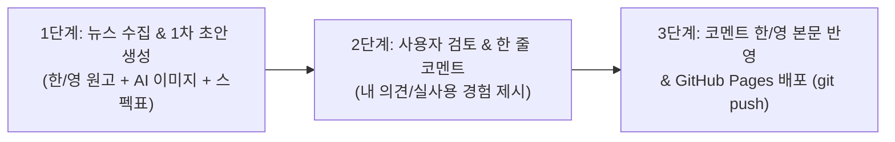

# 🌐 IT365.kr — 한/영 다국어 AI & IT 테크 블로그 자동화 마스터 플랜

이 문서는 **IT365.kr** 블로그 자동화 파이프라인의 전체 기획, 수익화 전략, SEO 안전장치, 그리고 운영 워크플로우를 모두 기록한 마스터 설계도입니다.

## 📚 프로젝트 핵심 규칙 및 체크리스트 문서
- **[블로그 구축 필수 체크리스트 & 저품질 방지 마스터 규칙 (BLOG_CHECKLIST_AND_RULES.md)](./BLOG_CHECKLIST_AND_RULES.md)**
- **[에이전트 상시 준수 워크스페이스 규칙 (.gemini/rules/it365-blog-rules.md)](./.gemini/rules/it365-blog-rules.md)**
- **[루트 디렉터리 자동 규칙 (GEMINI.md)](./GEMINI.md)**

---

## 1. 핵심 아키텍처 및 도메인 전략 (수정 반영 완료)

| 구분 | 설정 내용 | 상세 이유 및 기대 효과 |
| :--- | :--- | :--- |
| **플랫폼** | **GitHub Pages** | 서버 비용 0원, 마크다운 기반 빠른 렌더링, `git push`를 통한 100% 무인 배포 |
| **통합 도메인** | **`https://IT365.kr` (단일 통합)** | 도메인 분산 방지 및 도메인 권위(Domain Authority) 2배 집중, 애드센스 사이트 심사 1회로 단축 |
| **다국어 URL 구조** | • 한국어: `IT365.kr/ko/...` • 영어: `IT365.kr/en/...` | 서브디렉터리 기반 다국어 분리, 상단 `[🇰🇷 한국어 \| 🇺🇸 English]` 언어 전환 지원 |
| **연동 GitHub 계정** | `NestJC` (`gh` CLI 연동 완료) | 로컬 및 백그라운드에서 즉시 저장소 제어 및 배포 가능 |

---

## 2. 수익화(Monetization) 및 황금 비율 전략

### ① Google AdSense (한/영 전체 기본 수익)
* **계정 상태:** 기존 승인된 애드센스 계정 보유 → **`IT365.kr` 사이트 추가 심사** 진행
* **사이트 신청 시점:** 고품질 한/영 포스팅 **총 15~20편 누적 발행 직후** (하루 3~5편 기준 약 4~5일 소요)
* **사전 필수 세팅:**
  * 루트 경로 `ads.txt` 배치
  * 필수 정책 페이지 3종 구비: `About(소개)`, `Privacy Policy(개인정보처리방침)`, `Contact(문의)`
  * 애드센스 승인 완료 전까지는 모든 외부 제휴 링크(쿠팡파트너스) 스위치 `OFF` 유지

### ② 쿠팡파트너스 제휴 수익 (80 : 20 법칙 적용)
* **정보성 글 (70~80% 비중 — 순수 애드센스용):**
  * 매일 발행되는 글로벌 AI 이슈 및 기술 분석 글에는 쿠팡 링크를 넣지 않고 도메인 신뢰도(E-E-A-T)와 고단가(CPC) 애드센스 클릭에 집중합니다.
* **기기 리뷰/비교 글 (20~30% 비중 — 애드센스 + 한국어 쿠팡파트너스):**
  * 매주 일요일 발행되는 빅테크 신제품/루머 정리 및 디바이스 사용기(`IT365.kr/ko/`)에만 쿠팡파트너스 추천 박스를 배치합니다.
  * **영어 페이지(`IT365.kr/en/`)**는 쿠팡 링크를 제외하고 영미권 고단가 애드센스 수익에 집중합니다.
* **공정위 필수 문구 자동 삽입:**
  * 쿠팡 링크가 활성화된 한국어 포스팅에는 *"이 포스팅은 쿠팡 파트너스 활동의 일환으로, 이에 따른 일정액의 수수료를 제공받습니다."* 문구가 자동으로 삽입됩니다.

---

## 3. 주간/일간 콘텐츠 편성표 (Editorial Calendar)

| 주기 | 카테고리 | 세부 발행 방식 |
| :---: | :--- | :--- |
| **매일 (Daily)** *(하루 2~4편)* | **오늘의 글로벌 AI 이슈** | • 밤사이(미국 시간) 발표된 주요 AI 뉴스를 아침에 수집 • 검색 유입(SEO) 극대화를 위해 통합본이 아닌 **이슈가 발생한 기업/모델별(OpenAI, Google, Anthropic, Meta, NVIDIA 등)로 각각 독립 포스팅 분리 작성** (소식 없는 기업은 스킵) |
| **매주 일요일** *(주 2~3편)* | **빅테크 신제품 & 루머 총정리** | • **삼성(갤럭시/북), 애플(아이폰/맥/아이패드), 기타 빅테크** 브랜드별로 나누어 신제품 출시 일정·스펙·루머 총정리 발행 (쿠팡파트너스 연계 주력 카테고리) |
| **수시 (Ad-hoc)** | **AI 실전 활용기 & 기기 사용기** | • 직접 써본 AI 툴 후기, 프롬프트 팁, IT 디바이스 실사용 비교 |

---

## 4. AI 엔진, 이미지 및 문체 규칙

1. **AI 작성 엔진:** **Antigravity (`Gemini 4 Argon`)** 직접 활용 (제미나이 Pro 구독 혜택 활용으로 추가 API 과금 0원)
2. **이미지 파이프라인 (저작권 & 저품질 완벽 회피):**
   * 내장 AI 이미지 생성기(`image-generator`)를 통한 독창적 대표 썸네일 생성
   * 코드 기반 **핵심 스펙 비교표 / 요약 인포그래픽 카드** 자동 생성
   * 페이지 로딩 속도 최적화를 위한 **WebP 포맷 자동 압축** 및 한/영 맞춤형 `alt` 태그 자동 부여
3. **문체 (Tone & Manner):**
   * **한국어 (`/ko/`):** 신뢰감 있는 IT 전문 매거진 스타일인 **`~합니다 / ~입니다` 체**를 기본으로 하되, 상단 3줄 요약·장단점 비교·체크리스트 구간에서는 개조식 등 유연한 포맷을 혼용하여 기계적 패턴 방지 (AI 특유의 상투적 서론 금지)
   * **영어 (`/en/`):** 단순 직역이 아닌 **영미권 테크 미디어 문체 및 현지 검색 키워드 중심의 제목(Title)·URL 슬러그(Slug)**로 현지화 재작성 (가격 단위 등 USD 병기)

---

## 5. SEO 안전장치 및 검색엔진 등록 (추가 반영 완료)

1. **다국어 중복 문서(저품질) 방지 태그:**
   * 모든 한/영 짝꿍 글에 `<link rel="alternate" hreflang="ko" ...>`, `hreflang="en"`, `hreflang="x-default"` 상호 참조 태그 자동 삽입
   * 각 언어 페이지가 자기 자신을 가리키는 **Self-Referencing Canonical 태그** 적용
2. **국내외 검색엔진 3대장 동시 대응:**
   * **구글 서치콘솔 (Google Search Console):** 다국어 통합 `sitemap.xml` 제출
   * **네이버 서치어드바이저 (Naver Search Advisor):** 소유권 확인 메타태그 + 네이버 규격 `rss.xml` 및 `sitemap.xml` 자동 생성
   * **빙 웹마스터 도구 (Bing / ChatGPT Search):** `IndexNow` 프로토콜 대응
3. **내부 링크(Internal Linking) 자동 엮기:**
   * 새 글 작성 시 기존에 발행된 관련 글 2~3개를 본문 하단 **"👉 함께 읽으면 좋은 글"**로 자동 연결해 체류 시간 및 페이지뷰 증대
4. **자연스러운 시간차 분산 발행 (Velocity Control):**
   * 초안 생성 및 검토는 원하는 만큼 한 번에 진행하되, 실제 사이트 배포는 매크로 의심을 피하고 검색봇 선점 효과를 얻기 위해 **시간차(오전/오후/저녁, 한·영 시차)**를 두고 자연스럽게 반영

---

## 6. 일일 운영 워크플로우 (검수 및 발행 3단계)

1. **[자동 준비]** 안티그래비티가 최신 IT/AI 뉴스를 수집해 `drafts/` 폴더에 1차 초안(한국어 마크다운 + 영어 마크다운 + 이미지)을 생성합니다.
2. **[사용자 검토 & 경험 주입 (E-E-A-T)]** 사용자가 초안을 확인하고 본인의 생각이나 경험 한두 줄을 채팅으로 전달합니다.
3. **[최종 수정 & 발행]** 에이전트가 사용자의 의견을 한국어(`~합니다` 체)와 영어 본문 모두에 '에디터 인사이트'로 자연스럽게 녹여 수정한 뒤 GitHub에 배포합니다.
